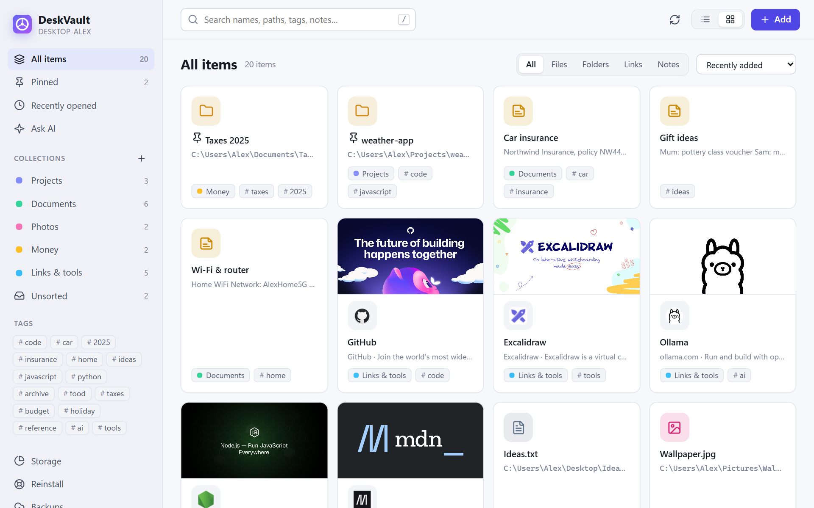
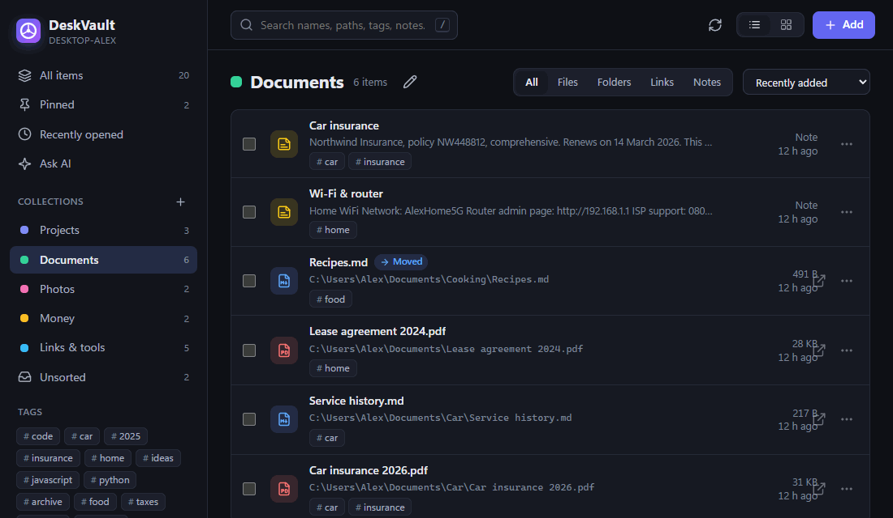
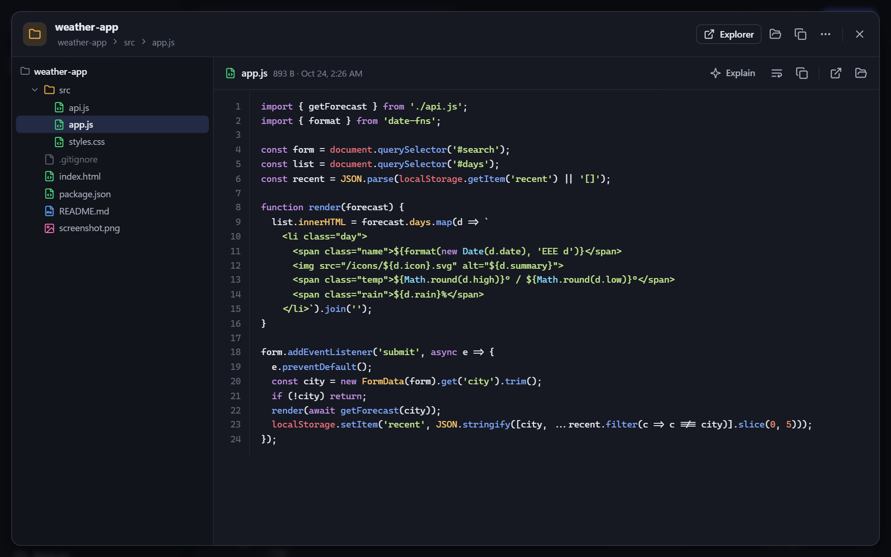
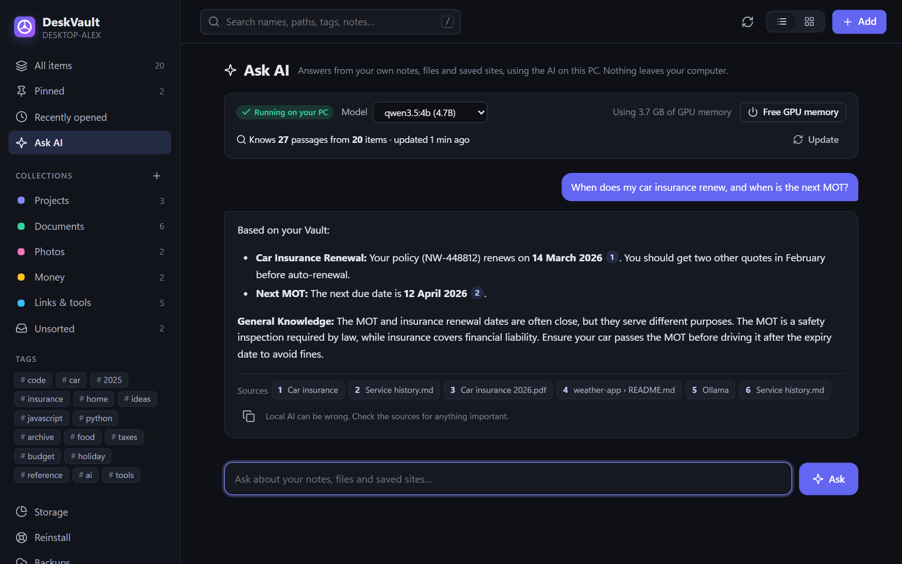
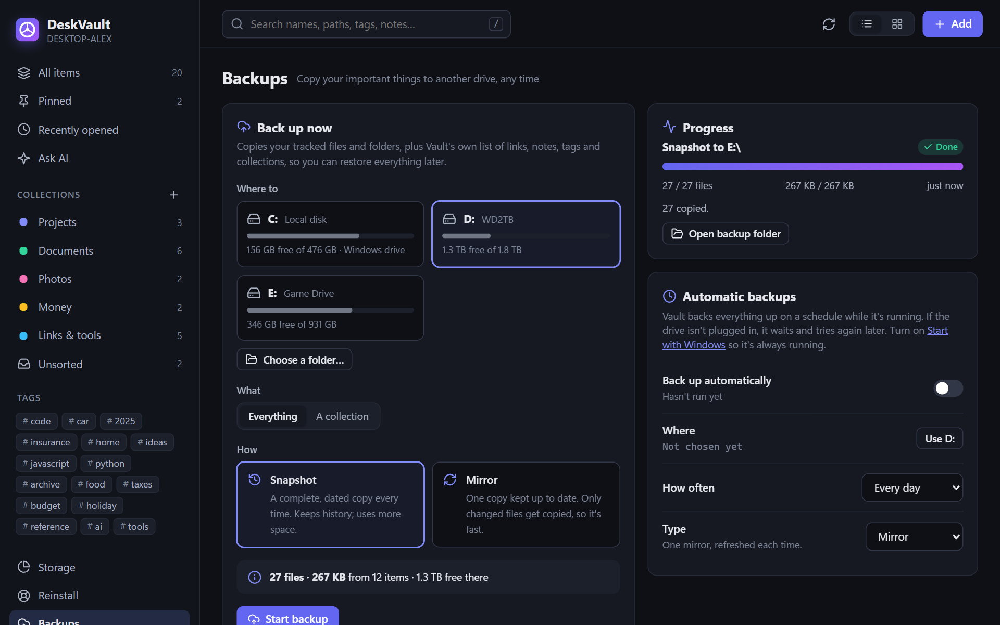
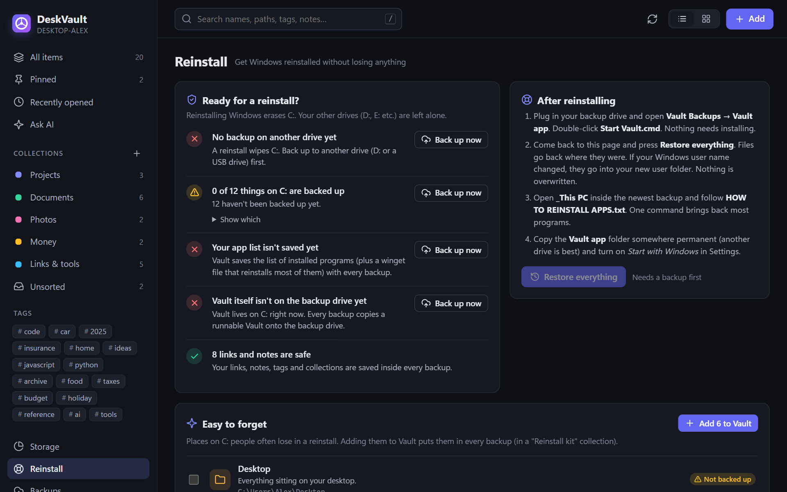
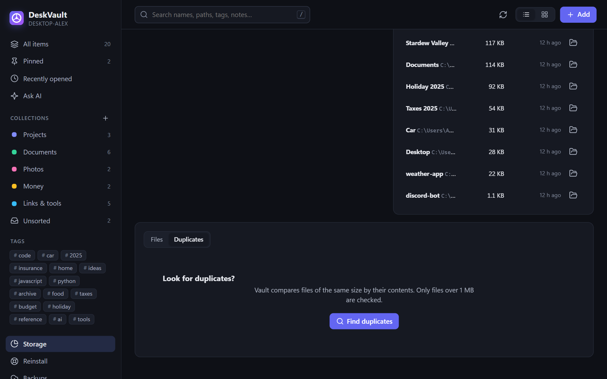

<div align="center">

# DeskVault

**A local home for your important files, folders, links and notes.**

Keeps track of them when they move, backs them up to any drive, and shows them
all in a browser you can leave open. Runs only on your PC. Nothing is uploaded.


<picture>
  <source media="(prefers-color-scheme: dark)" srcset="docs/images/library-grid-dark.png">
  
</picture>

</div>

## Why DeskVault

Your important stuff is scattered: a `Projects` folder, PDFs in Documents, a
few photos, saved websites in a bookmark bar you never open, notes in a chat
with yourself. If you reinstall Windows tomorrow, half of it is gone and you
won't remember which half.

DeskVault is one place for all of it. It **links** to your files &mdash; it
never moves or copies them &mdash; and it **follows** them when you rename,
move or reorganise. One click backs the whole lot up to a USB drive.

## What's in it

- **Your files stay where they are.** DeskVault links to them. If you remove
  something from DeskVault, the file on disk is untouched.
- **It follows them when they move.** Rename or move a file or folder and
  DeskVault finds it again &mdash; same drive, different drive letter, or
  copied-and-original-deleted. [How it works &rarr;](docs/features/tracking.md)
- **Back up to any drive, any time.** Dated snapshots or a fast mirror, by
  hand or on a schedule. Restore one item, or restore everything after a
  Windows reinstall. [More &rarr;](docs/features/backups.md)
- **Clean up safely.** "Remove from DeskVault" only forgets the item.
  "Delete from disk" sends it to the Recycle Bin.
- **Built-in viewer.** Highlighted code and text, rendered Markdown, PDFs,
  images, audio/video, HTML (scripts off), plus a folder tree.
- **Reinstall-ready.** A Reinstall page shows what a Windows reinstall
  would wipe that isn't backed up yet, suggests easy-to-forget folders
  (game saves, OBS, fonts, your PowerShell profile&hellip;), and restores
  everything in one click afterwards. [More &rarr;](docs/features/reinstall.md)
- **Storage manager.** Scan drives or folders to find big files you haven't
  opened in years, duplicates and old `node_modules`; send them to the
  Recycle Bin or move them to another drive.
- **Windows Hello lock.** Lock items or whole collections. They stay hidden
  until you unlock with your PIN, fingerprint or face.
- **Local AI (optional).** Ask questions about your own notes and files;
  answers cite numbered sources you can click. Runs on **your** GPU through
  [Ollama](https://ollama.com). [More &rarr;](docs/features/ai.md)

> [!NOTE]
> **Nothing leaves your PC.** DeskVault binds to `127.0.0.1` only. The only
> network traffic it makes is fetching the preview picture of a website you
> saved yourself, and talking to Ollama &mdash; also on your PC &mdash; if
> you turn Local AI on.

## See it in action

<table>
  <tr>
    <td align="center" width="33%"><b>Follows your files when they move</b><br><br></td>
    <td align="center" width="33%"><b>Highlighted code viewer</b><br><br></td>
    <td align="center" width="33%"><b>Ask AI (runs on your GPU)</b><br><br></td>
  </tr>
  <tr>
    <td align="center"><b>Backups to any drive</b><br><br></td>
    <td align="center"><b>Reinstall-ready</b><br><br></td>
    <td align="center"><b>Storage: duplicates & stale files</b><br><br></td>
  </tr>
</table>

## Install and run

> [!IMPORTANT]
> You need [Node.js 20 or newer](https://nodejs.org) (the LTS installer is
> fine). The viewer libraries download the first time you run it.

1. [Download the latest release](https://github.com/TCPeep/DeskVault/releases/latest) and unzip it anywhere.
2. Double-click **`Start Vault.cmd`**. The first run installs the viewer
   libraries and compiles the small Windows helper from `native/*.cs`, then
   opens <http://127.0.0.1:4477> in your browser.
3. In **Settings &rarr; Windows**, turn on *Start with Windows* so tracking
   and automatic backups keep working.

To stop it, click **Stop** on the Settings page.

Prefer the command line?

```powershell
git clone https://github.com/TCPeep/DeskVault.git
cd DeskVault
npm install
npm start   # opens http://127.0.0.1:4477
npm test    # end-to-end smoke test on throwaway files
```

## Adding things

- **Add &rarr; Files&hellip; / Folders&hellip;** opens the Windows picker.
- Or copy a path (Explorer: hold <kbd>Shift</kbd>, right-click, *Copy as
  path*) and press <kbd>Ctrl</kbd>+<kbd>V</kbd> anywhere in DeskVault.
- The **Save to Vault** bookmark in Settings saves any website you're on
  (title, description and preview image) when you click it on your bookmarks
  bar.

Browsers hide where dragged-in files live, so drag-and-drop from Explorer
can't be used.

## How moved files are found

```mermaid
flowchart TD
    A[Check tracked path every minute] --> B{Found at<br/>last location?}
    B -- yes --> OK[OK]
    B -- no --> C{Same NTFS drive?}
    C -- yes --> D[Ask Windows for the<br/>file's NTFS ID]
    D --> E{Found elsewhere<br/>on the drive?}
    E -- yes --> UP[Update path<br/>silently]
    E -- Recycle Bin --> RB[Mark 'In Recycle Bin']
    C -- different drive --> F{USB with new letter?}
    F -- yes --> G[Match by drive<br/>serial number]
    G --> UP
    F -- no --> H[Search near old path,<br/>home folder, other drives]
    H --> I{Content<br/>fingerprint matches?}
    I -- yes --> UP
    I -- no --> J[Show on<br/>'Needs attention' page]
    style UP fill:#193a1f,stroke:#4ade80
    style OK fill:#193a1f,stroke:#4ade80
    style RB fill:#3a2a11,stroke:#fbbf24
    style J fill:#3a1818,stroke:#f87171
```



[Full explanation with examples &rarr;](docs/features/tracking.md)

## Backups

```
<drive>\Vault Backups\
    2026-10-24 15.30.12\   dated snapshot (full copy each time; keeps history)
    Mirror - DESKTOP-ALEX\ mirror (one copy; only changed files re-copied)
    Vault app\             a runnable copy of DeskVault, with Node.js included
    READ ME FIRST.txt      how to restore after reinstalling Windows
```

Every backup also saves your installed-apps list and a runnable copy of
DeskVault with Node.js included. After reinstalling Windows, open
`Vault Backups\Vault app\Start Vault.cmd` on the backup drive, go to
**Reinstall &rarr; Restore everything**, and follow the printed
`HOW TO REINSTALL APPS.txt` to bring your apps back with one
`winget import` command. [More &rarr;](docs/features/reinstall.md)

## Lock

A privacy screen *inside* DeskVault: locked names, paths and contents never
reach the browser until you unlock with Windows Hello. Locked files can't be
opened, removed or deleted through DeskVault.

> [!WARNING]
> The files on disk are **not encrypted** &mdash; Lock is a privacy screen,
> not file encryption. If Windows Hello ever stops working, locks can be
> removed by setting `"locked": false` in `data\library.json` while
> DeskVault is stopped.

## Delete from disk

> [!WARNING]
> **"Delete from disk"** and **"Move to another drive"** change your files.
> *Delete* always sends files to the Recycle Bin (not permanent deletion).
> *Move* copies, verifies, then removes the original, keeping the layout
> under `<drive>\Vault Archive\`. *Restore* from a backup never overwrites:
> if something already exists at the original location, the restored copy
> lands beside it.

## Files

| Path | What |
|---|---|
| [`server.js`](server.js) | Local web server + API (binds to 127.0.0.1 only) |
| [`lib/tracker.js`](lib/tracker.js) | Move detection (file IDs, drive letters, search) |
| [`lib/backup.js`](lib/backup.js) | Snapshots, mirrors, restore-everything, import, purge |
| [`lib/storage.js`](lib/storage.js) | Storage scan, stale/large files, duplicates, clean-up |
| [`lib/reinstall.js`](lib/reinstall.js) | Real folder locations, easy-to-forget list, apps list, self-copy |
| [`lib/ai.js`](lib/ai.js) | Local AI through Ollama, with text index for citations |
| [`lib/links.js`](lib/links.js) | Website previews (saved to `data/thumbs`) |
| [`native/*.cs`](native/) | Small Windows helper (file IDs, pickers, Recycle Bin, Hello) and `Vault.exe` launcher &mdash; compiled by the C# compiler built into Windows |
| [`public/`](public/) | The web app |
| `data/library.json` | Your library. Daily copies of the last 14 days live in `data/history/` |

## More documentation

- [Getting started](docs/getting-started.md)
- [Features](docs/features/)
- [Architecture](docs/architecture.md)
- [FAQ](docs/faq.md)
- [Troubleshooting](docs/troubleshooting.md)

## Contributing & bugs

Pull requests welcome. Please read [CONTRIBUTING.md](CONTRIBUTING.md) first
and run `npm test` before opening one. Security issues: [SECURITY.md](SECURITY.md).

## License & credit

DeskVault is free software under the [GNU GPL version 3](LICENSE) with
additional terms in [NOTICE](NOTICE): you can use, change and share it, but
copies must keep the author credit. See the About panel in Settings for the
in-app credit.

&copy; 2026 **TCPeep** &mdash; <https://github.com/TCPeep>
