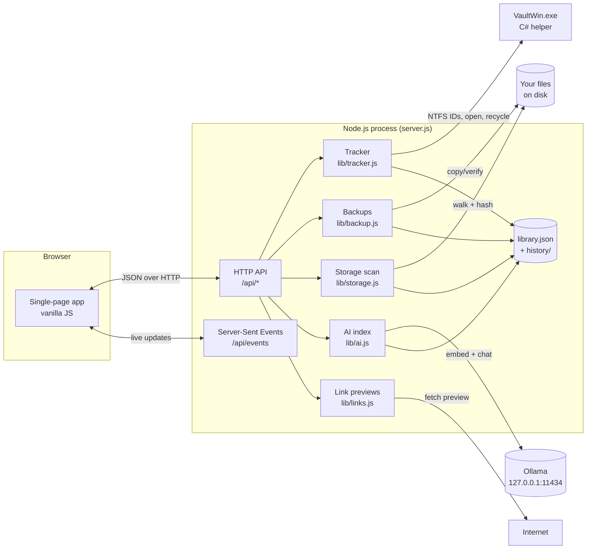

# Architecture

DeskVault is one Node.js process serving a single-page app over `127.0.0.1`, plus a small Windows helper written in C# for things Node can't do well (NTFS file IDs, native pickers, Recycle Bin, Windows Hello).

## Why not Electron?

A browser you already have is lighter, updates itself, and lets you leave DeskVault running in a background tab. The small Windows helper does the few things a browser can't: NTFS file IDs for tracking, native file pickers, Recycle Bin, Windows Hello.

## The store

`data/library.json` is the only source of truth. Writes are atomic (temp file + rename) and a dated copy is kept in `data/history/` for the last 14 days, so a bad edit can always be rolled back by hand.

## Native helper (`bin/VaultWin.exe`)

Compiled from `native/VaultWin.cs` and `native/Launcher.cs` using the C# compiler built into every Windows 10/11 (`%WINDIR%\Microsoft.NET\Framework64\v4.0.30319\csc.exe`). The first run compiles it and writes a hash stamp; it rebuilds only when the sources change. Everything the helper does is in one short switch statement: `resolve`, `pick`, `recycle`, `drives`, `open`, `reveal`, `hello-check`, `hello`, `binsize`, `emptybin`, `shortcut`.

## Live updates

`/api/events` is a Server-Sent Events stream. The server pushes `items`, `moved`, `job`, `search`, `backups`, `storage`, `ai` events; the UI reflects them without polling. Moved-event payloads for locked items are redacted so a locked path can never appear in a toast.

## Zero copying

DeskVault never copies your files into its data folder. The library stores paths and file fingerprints. Backups copy to a drive you chose; backups never go through DeskVault's data folder.

## Network footprint

- Binds to `127.0.0.1:4477` only. No LAN access, by design.
- Fetches website previews over HTTPS (title, description, Open Graph image) when you save a link, and when you ask for a refresh.
- Talks to Ollama at `127.0.0.1:11434` if Local AI is on.
- That's everything.
