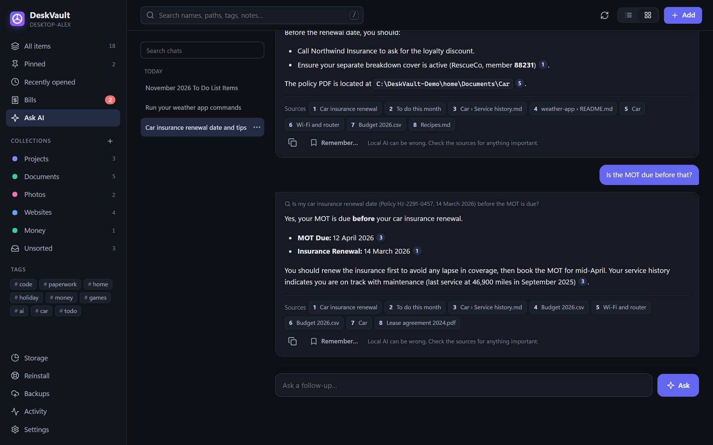
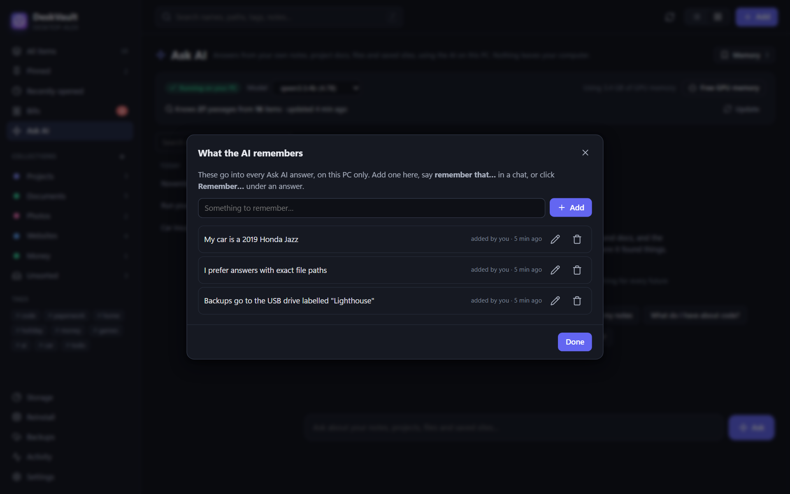

# Local AI (Ask AI)

Ask questions about your own notes, saved sites and the text/Markdown/code files inside your tracked items. Answers cite numbered sources you can click. Runs on **your** PC's GPU through [Ollama](https://ollama.com).

## Setup

1. Install Ollama from <https://ollama.com>.
2. Open the **Ask AI** page in DeskVault.
3. Click **Download search helper** &mdash; this is `nomic-embed-text` (~250 MB), the embedding model DeskVault uses to find relevant passages.
4. Pick a chat model from the dropdown. Models already pulled through Ollama appear automatically. If none are installed, click **Pull a model** and pick one (e.g. `llama3.2:3b` for 8 GB VRAM, `qwen2.5:7b` for 12 GB+).
5. Ask.

## What it indexes

- Markdown notes you've created in DeskVault.
- Saved website descriptions and titles.
- Text and Markdown files inside tracked items (folders are walked; binary files are skipped).
- Source files (`.js`, `.ts`, `.py`, `.ps1`, `.cs`, &hellip;) up to a per-file size limit.

**Not indexed:** anything inside a locked item or locked collection. The ignore list respects your backup excludes (`node_modules`, `.venv`, &hellip;). The index lives in `data\ai-index.json` and updates in the background when things change (turn off in Settings).

- **Project overviews.** Each project folder (a git repo, or a folder with `package.json`, `.sln`/`.csproj`, `pyproject.toml`/`requirements.txt`, `Cargo.toml` or `go.mod`), up to two levels inside a tracked folder, gets a generated overview: location, stack, git remote and branch, npm scripts, the start of its README and its top-level layout. These answer "where is…", "how do I run…" and "which projects have no remote?". READMEs, hand-off notes and `docs/` files are read first and in more detail than other notes.

## Saved chats

Every conversation is saved in `data\ai-chats.json` and listed next to the chat. Search, reopen, rename, pin or delete them from there. Follow-up questions keep the conversation in mind: DeskVault rewrites them into a standalone search first and shows that search above the answer.

If you lock an item later, saved chats show its sources as "Locked item", but the answer text stays. Delete a chat if it quotes something you have since locked.

## Memory

Memory is a short list of facts the AI keeps in mind for every answer, such as "My website's deploy script is in Projects\site\deploy.ps1" or "I'm on Windows 11 with an AMD GPU". It's stored in `data\ai-memory.json`.

- Start a message with **remember that…** to add a fact, or **forget…** to remove the closest match.
- Click **Remember…** under an answer and the AI suggests facts from it. Tick and edit the ones to keep.
- Open **Memory** to add, edit or remove facts.

Memory is copied into backups and restored by library import. It isn't tied to locked items, so don't put anything there you'd want hidden.

## Free GPU memory

Click **Free GPU memory** on the Ask AI page before gaming &mdash; this calls Ollama's unload. Ollama also unloads by itself after 2 idle minutes (`OLLAMA_KEEP_ALIVE=2m`, set as a user environment variable by DeskVault).

## Model notes

DeskVault sets `OLLAMA_CONTEXT_LENGTH=16384` so long files fit in context. If your card can't hold that, lower it in Ollama's settings and restart.

## Why local

- Your notes, your files, your car insurance number &mdash; none of them leave the PC.
- No API bill.
- Works offline.
- Locked items are never shown to the model.

The trade-off: smaller models (3B-7B) are less capable than hosted ones. For "find me the thing in my own files" tasks they're usually fine.
