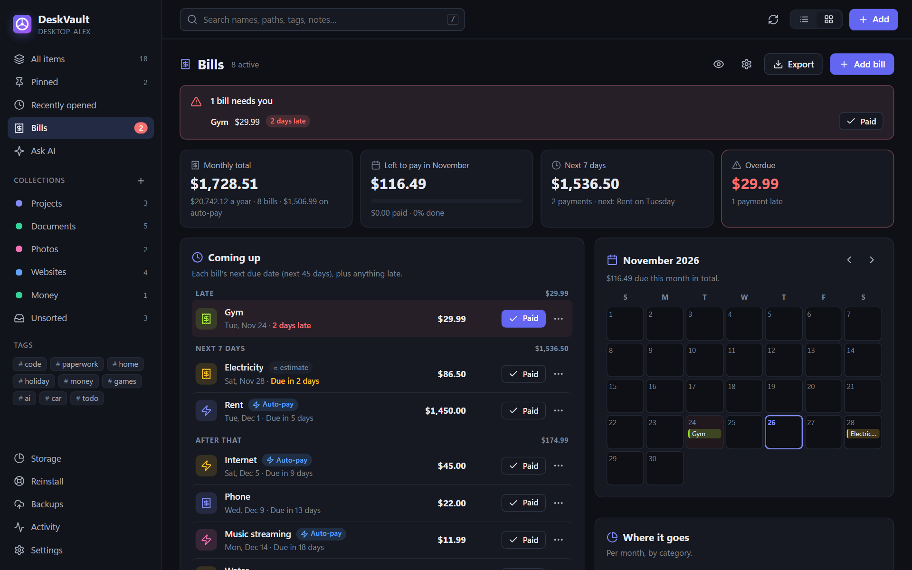

# Bills

A page for what you pay regularly: rent, utilities, subscriptions, insurance. Open **Bills** in the sidebar.

## What it shows

- **Monthly total.** Weekly, every-2-weeks, quarterly, every-6-months and yearly bills are evened out so the total is what you really spend in an average month, plus the yearly figure.
- **Left to pay this month**, what's due in the **next 7 days**, and anything **overdue**.
- **Coming up:** each bill's next due date for the next 45 days, grouped into late, next 7 days and after that.
- A **month calendar**, charts of where the money goes by category, and what you paid in each of the last 6 months.

## Paying, skipping, undoing

- **Paid** records the payment and moves the bill to its next due date. A bill due on the 31st stays on the last day of shorter months.
- For bills that change each time (electricity, phone), mark them **variable** and enter the real amount when you pay.
- **Auto-pay** bills ask you to confirm the payment went through instead of showing as late.
- You can **skip** a payment or **undo** the last one. **Export** gives you a CSV of payments (protected against spreadsheet formula injection).

## Privacy

- Lock bills behind **Windows Hello** (gear icon on the Bills page). Names, amounts and dates stay out of the browser and the activity log until you unlock.
- The **eye** icon blurs amounts while you share your screen.
- DeskVault only stores the last 4 digits of an account or card number, and payment links must be plain http(s) addresses with no logins in them.

Bills are included in backups and in library import. Optional Windows notifications remind you before bills are due.
