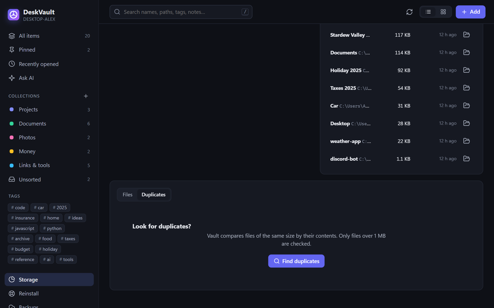
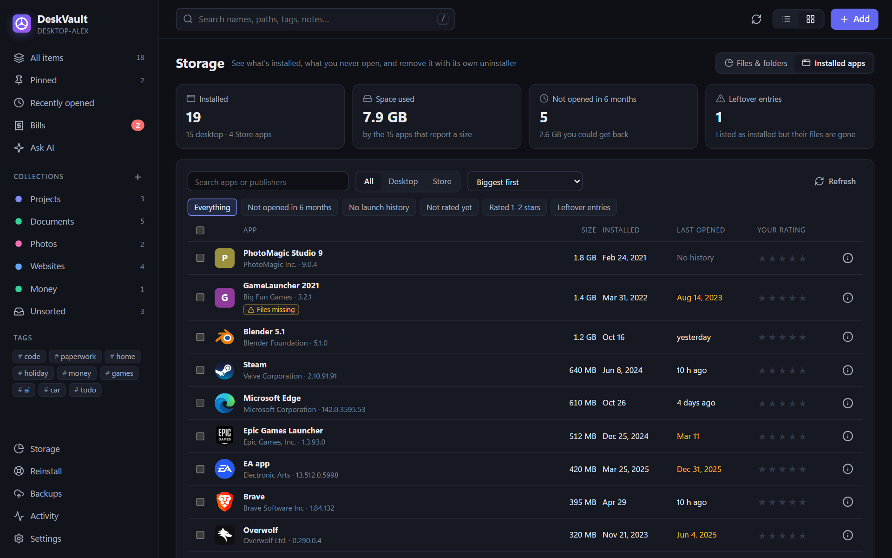
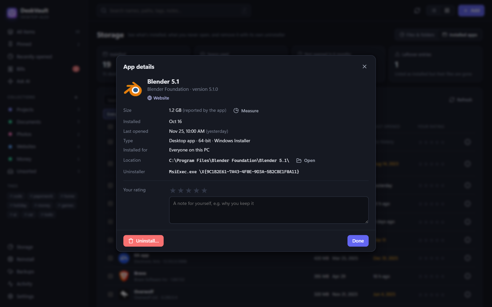
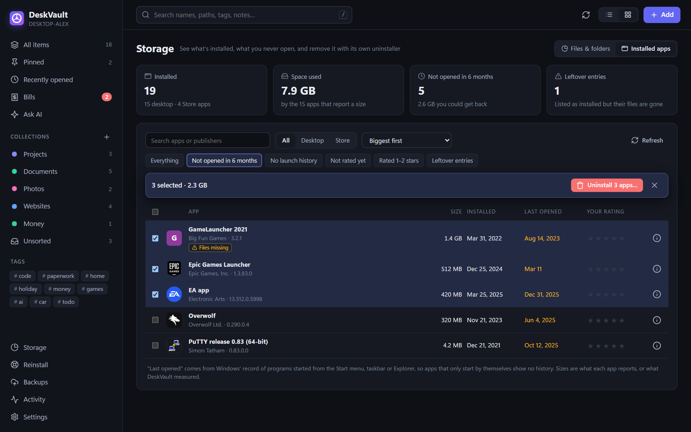

# Storage

Scan any folders or drives to find what's taking space, what you haven't opened in years and what you have more than one copy of. Then clean up safely.

## What it does

- **Scan** picks up every file under the folders you pick (default: your user folder).
- Reports totals by **age**: last opened < 6 months, 6-12 months, 1-2 years, 2-3 years, 3+ years.
- Finds **duplicates**: files with the same size and SHA-256. Grouped so you can keep one and recycle the extras.
- Flags **old `node_modules`**: rebuildable, often enormous, usually safe to delete.
- Shows the current **Recycle Bin** size with an **Empty** button.

## Age "basis"

By default, "age" means **last opened** (NTFS atime). Windows PCs record this on NTFS drives. Switch to **last changed** (mtime) if you prefer, from the Storage page's gear icon.

Backing a file up never bumps its atime: DeskVault puts it back after copying, so a weekly backup doesn't make everything look recently used.

## Safe clean-up

- **Delete** sends files to the **Recycle Bin**. The space comes back when you empty it.
- **Move to another drive** copies, verifies, then removes the original, keeping the layout under `<drive>\Vault Archive\`. If the destination has free space problems or the verify fails, nothing is removed.

> [!WARNING]
> Deleting a file that another program is actively using (an open video, a running database) can misbehave. Close the program first if you're not sure.

## Add to DeskVault

If a scan surfaces a folder you'd forgotten about and want to keep track of, select it and click **Add to Vault** &mdash; it joins your library like any other item.

## Installed apps

Switch the Storage page to **Installed apps** (top right) to see every desktop program and Microsoft Store app on the PC.

- **What's listed:** programs from the Windows "Apps & features" list (all users and just you, 64- and 32-bit) and Store apps that have a Start menu entry. Updates, system components and frameworks are left out.
- **Last opened** comes from Windows' own record of programs started from the Start menu, taskbar or Explorer. Apps that only start by themselves (services, tray helpers, games launched from another launcher) show *No history*.
- **Size** is what each app reports to Windows. If it doesn't, open its details and click **Measure** to add up its install folder.
- **Leftover entries** are apps Windows still lists whose files are gone. Their uninstaller may fail; the entry itself is harmless.
- **Your rating:** give apps 1 to 5 stars and a note (why you keep it, what it's for). Filter by *Rated 1&ndash;2 stars* when it's time to clear out. Ratings stay on this PC.

### Uninstalling one or many

Tick one or more apps (or open an app's details) and click **Uninstall**. DeskVault runs each app's **own uninstaller**, the same one Windows Settings uses, **one at a time**, because Windows installers can't run side by side.

- Windows may ask for permission for each app, and the uninstaller's window can open behind your browser. Check the taskbar.
- DeskVault waits until the app is really gone from Windows' list before starting the next, including uninstallers that hand off to a temporary copy of themselves. Each one ends as *Uninstalled*, *Still installed* (you closed the uninstaller without finishing), *Skipped* or *Cancelled*.
- **Skip this one** moves on without waiting; **Cancel the rest** stops after the current app.
- Settings and saved files that an app keeps in your user folder may stay behind, the same as when uninstalling from Windows.

> [!NOTE]
> The uninstall command is always read from the Windows registry by DeskVault itself; the browser only sends which apps you picked.
