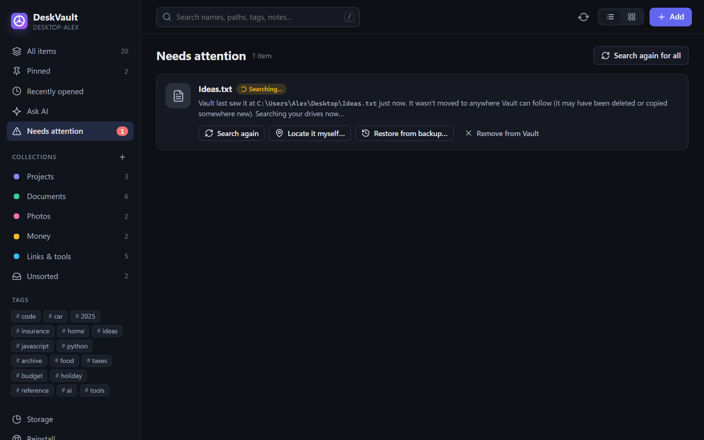

# Tracking: how moved files are found

Every tracked item is checked on a schedule (default: every minute, adjustable in Settings). When the file isn't where DeskVault last saw it, these steps run in order until one of them finds it:

## 1. Same drive &rarr; ask Windows for the NTFS ID

Every file and folder on an NTFS drive has an ID (`FileReferenceNumber`) that survives moves and renames on that volume. DeskVault stored the ID when the item was added, so it can ask Windows "where is file ID X now?". This is instant and exact.

If the file is in the Recycle Bin, DeskVault marks the item **In Recycle Bin** rather than treating it as moved.

## 2. USB drive got a new letter

External drives get a new letter when plugged into a different PC. DeskVault remembers the drive's volume serial number as well as its letter, and matches on the serial first.

## 3. Copied elsewhere and the original deleted

DeskVault searches *near* the old location, then in your user folder, then in the roots of other fixed drives. For each candidate it compares file size and a content fingerprint (first + last KB SHA-256) before switching the item over. Near-misses (same name, different content) are shown on the **Needs attention** page with a *Suggestions* button.

## 4. Drive unplugged

If the whole drive is gone, the item shows as **Drive not connected**. Nothing is lost; the item comes back when you plug the drive in.

## 5. Nothing found

The item lands on **Needs attention** with the choice to **Search again**, **Locate it myself&hellip;**, **Restore from backup&hellip;**, or **Remove from Vault**.

## Settings that matter

- **Check locations every**: 30 s / 1 min / 5 min / 15 min.
- **Places to search**: a list of folders. Add drives or project roots. DeskVault always looks near the old path first; this list is the fallback.
- **Also search other drives**: when on, DeskVault looks on the roots of other fixed drives (not the Windows drive).

System folders, `AppData`, `node_modules`, `.git` and the Recycle Bin are always skipped.

## Why this design

Full-text file hashing of every drive is slow. NTFS file IDs are instant and exact for the common case (moved or renamed on the same drive), and the fingerprint check catches the "copied, original deleted" case without false positives. On the rare case where everything fails, you get a clear page with options instead of silently losing the item.
